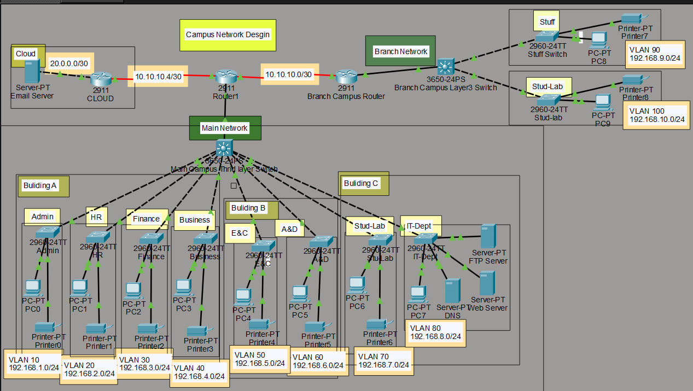

📶 Campus Network Design

  its is a network design made for a campus with different components with the intention of clearly showing how different components are configured
  
⚙️ Components used:-

    ◈ 3 Routers

    ◈ 2 layer 3 Switches

    ◈ 10 layer 2 Switches

    ◈ and other components like Computers,Printers and servers
    
💻 configuration done:-

    ▫️Basic setting (hostname,motd,password) config to all the devices,
    ▫️DHCP on the Router,
    ▫️VLAN assignments and choosing access and trunk ports,
    ▫️Switchport-security,
    ▫️Routing protocol,
    ▫️FTP, WEB and email server initiation
    
🎯 To run it locally:- after downloading

    ◈ Either pick a packet and assign it to 2 end devices and watch it in real-time by run a simulation.
    ◈ or go to the terminal of the pc and ping the device of interest.
    ◈ PS there is a firewall added to the server, hence pings made to the servers are denied
